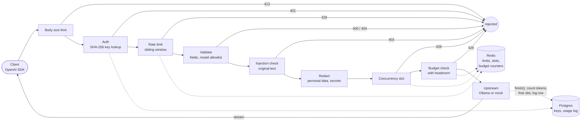

# Bouncer

A self-hosted LLM gateway with security guardrails. Any OpenAI client can use it by changing
one URL: it checks who is calling, enforces per-key rate and concurrency limits, and streams
the model's answer back.

See [SPEC.md](SPEC.md) for the brief and [DESIGN.md](DESIGN.md) for every design decision,
its reasoning, and the loopholes it closes.

## Status

| Feature | State |
|---|---|
| OpenAI-compatible `/v1/chat/completions`, streaming and non-streaming | ✅ |
| Hashed per-team API keys, admin API (create / list / revoke, optional expiry) | ✅ |
| Sliding-window rate limit (Redis + Lua), per-key concurrency limit | ✅ |
| Docker Compose stack with a mock upstream for load tests | ✅ |
| Usage logging, monthly token budgets with headroom | ✅ |
| Redaction of personal data and secrets, prompt-injection blocking | ✅ |
| Dashboard (keys, usage, blocked requests) | ✅ |
| CI: lint, tests against Postgres + Redis, evaluations, dashboard build, Docker builds | ✅ |
| Prometheus metrics (separate internal port), readiness probe | ✅ |
| Kubernetes, load-test numbers | Week 3 |

## How a request flows

Each step can turn a request away; the status code it returns is on the arrow.



The pipeline order is deliberate (see [DESIGN.md](DESIGN.md)): cheap checks first; injection
detection sees the original text before redaction; the concurrency slot is taken **before**
the budget check and released **after** the tokens are counted, which is what makes the
budget a hard limit. Metrics go to Prometheus on a separate internal port; raw prompts are
never stored anywhere.

## Run the whole stack in Docker

Needs Docker Desktop. For real answers, also Ollama running natively with a model pulled
(`ollama pull qwen2.5:0.5b`).

```powershell
copy .env.example .env      # then set BOUNCER_ADMIN_TOKEN (see the comment in the file)
docker compose --profile app up -d --build --wait
```

This starts Postgres, Redis, the migrations, the gateway on http://localhost:8000, the
mock upstream on http://localhost:8001, the dashboard on http://127.0.0.1:3000 and Prometheus
on http://127.0.0.1:9090. [models.yaml](models.yaml) decides which model goes
where: `qwen2.5:0.5b` and `llama3.2:3b` go to Ollama on the host, and `mock` goes to the
mock upstream (fast and predictable, for load tests). Models not listed are rejected.

## Dashboard

Open http://127.0.0.1:3000 (started by the `app` profile above). Three pages:

- **Keys**: create (the full key is shown once), revoke, limits, this month's budget bar, expiry.
- **Usage**: tokens per day per key, cost, average and p95 latency, time to first token, errors.
- **Blocked**: blocked and would-have-blocked requests, with rule ids and scores only.

The dashboard holds the admin token on its server (it never reaches the browser), and since v1
has no logins, anyone who can open it is the admin. So it is published on `127.0.0.1` only. To
reach it on a remote machine, use an SSH tunnel or `kubectl port-forward`, never a public port.

To work on it locally: `cd dashboard`, `npm install`, then
`BOUNCER_ADMIN_TOKEN=... GATEWAY_URL=http://localhost:8000 npm run dev`.

## Use it

Create a team key with the admin token. The full key is shown **once**:

```powershell
curl -X POST http://localhost:8000/admin/keys -H "Authorization: Bearer <admin token>" -H "Content-Type: application/json" -d "{\"team_name\": \"demo\", \"rpm_limit\": 60, \"max_concurrent\": 4}"
```

Call the model through the gateway, exactly like the OpenAI API:

```powershell
curl http://localhost:8000/v1/chat/completions -H "Authorization: Bearer <team key>" -H "Content-Type: application/json" -d "{\"model\":\"qwen2.5:0.5b\",\"stream\":true,\"messages\":[{\"role\":\"user\",\"content\":\"Say hi\"}]}"
```

Or with the official OpenAI Python SDK:

```python
from openai import OpenAI

client = OpenAI(base_url="http://localhost:8000/v1", api_key="<team key>")
reply = client.chat.completions.create(model="qwen2.5:0.5b", messages=[{"role": "user", "content": "Say hi"}])
```

| Endpoint | Purpose |
|---|---|
| `POST /v1/chat/completions` | Chat, `stream: true` or `false` |
| `GET /v1/models` | Models the gateway routes to |
| `POST /admin/keys` | Create a key (returned once, stored as a SHA-256 hash) |
| `GET /admin/keys` | List keys (display prefix only) |
| `DELETE /admin/keys/{id}` | Revoke a key |
| `GET /admin/usage?days=7&bucket=day` | Tokens, cost, latency (avg, p95, time to first token) and outcomes per key, plus a time series |
| `GET /admin/blocked` | Requests blocked by injection detection (or that would have been, in monitor mode): rule ids and scores only |
| `GET /healthz` | Liveness: the process is up (never checks dependencies) |
| `GET /readyz` | Readiness: Postgres and Redis reachable (503 if not) |
| `:9100/metrics` | Prometheus metrics, on a separate internal port |

## Develop locally

```powershell
python -m venv .venv
.venv\Scripts\Activate.ps1
pip install -e ".[dev]"

docker compose up -d --wait   # just Postgres and Redis
alembic upgrade head
uvicorn app.main:create_app --factory --reload
```

(Stop the Docker gateway first if it's running, since both use port 8000.)

## Test

Tests use the `bouncer_test` database and Redis database 1, in the same containers.

```powershell
docker compose up -d --wait
pytest
```

## Security notes

- **Raw prompts are never stored.** Only the minimum needed for accounting will be logged.
- **API keys are stored only as SHA-256 hashes.** The full key is shown once, at creation.
- **The gateway refuses to start** without an admin token of at least 32 characters.
- **No TLS inside the gateway.** In a real deployment TLS ends at the ingress or load balancer.
