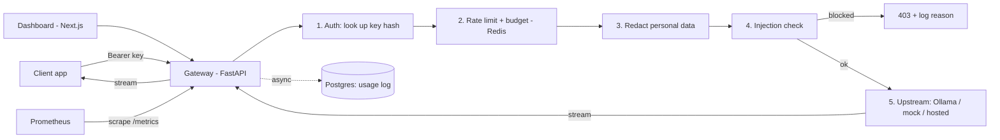

# Bouncer: a self-hosted LLM gateway with security guardrails

*(Working name. Rename it whenever you like.)*

## In one sentence

One front door for every app that calls an LLM: it checks who's calling, enforces limits and budgets, strips sensitive data and blocks prompt-injection attempts before they reach the model, streams the answer back, and records what everything cost.

## The problem it solves

When a team starts using LLMs, every app talks to the model directly. Nobody knows who is spending what, one runaway script can eat the whole budget, people paste customer emails and API keys into prompts, and nothing stops a prompt-injection attack. A gateway fixes all of that in one place.

## Goals (v1, three weeks)

- OpenAI-compatible API, so any existing OpenAI client works by changing one URL
- Streaming responses (token by token)
- Per-team API keys, stored hashed
- Per-key rate limits and monthly token budgets
- Redaction of personal data before the prompt reaches the model
- Prompt-injection detection, with blocked attempts logged
- Usage logging: tokens, latency, cost per key
- Dashboard for keys, usage and blocked attacks
- Tests + CI, Prometheus metrics, Kubernetes deployment, load-test numbers

## Non-goals (say no to these)

- Training or fine-tuning models
- Payments or real billing
- Multi-region / high-availability setups
- Matching every LiteLLM feature
- User accounts with passwords (an admin token is enough for v1)

## How a request flows

## API

| Method | Path | What it does |
|---|---|---|
| POST | `/v1/chat/completions` | OpenAI-compatible chat, `stream: true` or `false` |
| GET | `/v1/models` | Models the gateway can route to |
| POST | `/admin/keys` | Create a key (returned once, stored hashed) |
| GET | `/admin/keys` | List keys (prefix only, never the full key) |
| DELETE | `/admin/keys/{id}` | Revoke a key |
| GET | `/admin/usage` | Tokens, latency and cost per key over time |
| GET | `/admin/blocked` | Blocked requests and the reason |
| GET | `/healthz` | Health check |
| GET | `/metrics` | Prometheus metrics |

## Data model

**api_keys**: id, team_name, key_prefix, key_hash, rpm_limit, monthly_token_budget, created_at, revoked_at

**requests**: id, key_id, model, prompt_tokens, completion_tokens, latency_ms, time_to_first_token_ms, status, blocked_reason, created_at

Raw prompts are **not stored** by default. That's a security decision worth explaining in the README and in interviews.

## What I write myself vs what comes from libraries

Write these by hand. They are the interesting parts and what interviewers will ask about:
- The streaming proxy (relaying server-sent events from upstream to client)
- The sliding-window rate limiter in Redis
- The redaction module and its tests
- The injection-detection rules

Libraries are fine for: FastAPI, httpx, SQLAlchemy or asyncpg, redis-py, prometheus_client, pytest, Next.js.

## Milestones

**Week 1, v1 ships:** proxy → streaming → hashed keys → rate limiting → docker-compose + README
**Week 2, security edge:** usage logging → redaction → injection blocking → dashboard → tests + CI
**Week 3, production:** kind cluster → Prometheus → k6 load test → fix the weakest spot → re-measure → diagram + demo video

## How I'll measure it (these become resume numbers)

- **Gateway overhead:** p50 / p95 latency added on top of calling the model directly
- **Throughput:** requests per second through the gateway, using a **mock upstream** that streams canned tokens. A CPU model is always the bottleneck, so the mock isolates the gateway's own performance.
- **Redaction quality:** catch rate and false positives on ~100 hand-written test prompts
- **Injection detection:** catch rate on ~50 known injection prompts collected from public sources, false-positive rate on ~50 normal prompts
- **Before/after:** one optimization with numbers on both sides

## Local setup (Windows 11, 16 GB RAM)

- Docker Desktop on WSL2. Cap WSL at about 8 GB of memory in `%UserProfile%\.wslconfig` so Windows stays responsive.
- Ollama runs natively on Windows. Containers reach it at `http://host.docker.internal:11434`.
- Models: `qwen2.5:0.5b` for tests (fast), a ~3B model like `llama3.2:3b` for demos (better answers).
- docker-compose services: gateway, postgres, redis, mock-upstream (dashboard added in week 2).
- Week 3: a local `kind` cluster.

## How I'll work with Claude Code

- I design each piece first: what it should do and how. Claude Code helps me build it, explains anything unfamiliar, writes tests and boilerplate, and reviews my code.
- I write the four core pieces listed above myself, with help when I get stuck.
- Rule: I must be able to explain every file in an interview.
- Small commits, one feature each, so the git history shows real progress.
